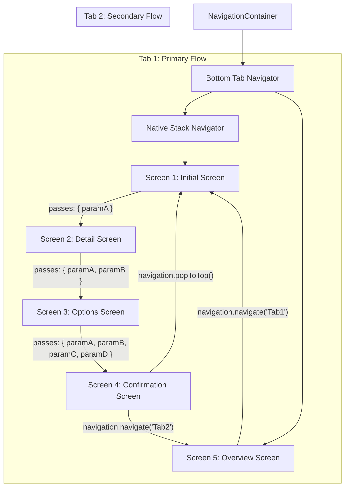

# React Navigation Architecture & Implementation

A React Native project demonstrating core and advanced **React Navigation (v7)** concepts, including nested navigators, route parameter propagation, dynamic navigation header customization, interactive header actions, and stack history manipulation.

---

## 🧭 Navigators Used

This application demonstrates a **Nested Navigator Architecture** combining two primary navigation paradigms:

1. **Bottom Tab Navigator (`@react-navigation/bottom-tabs`)**:
   - Serves as the root navigation container (`Tab.Navigator`).
   - Manages top-level application tabs (`Tab 1` and `Tab 2`).
   - Configured with custom tab bar styling, active/inactive color palettes, and tab icons.

2. **Native Stack Navigator (`@react-navigation/native-stack`)**:
   - Nested inside `Tab 1` as a child navigator (`Stack.Navigator`).
   - Manages sequential multi-step navigation flows across 4 distinct screens.
   - Leverages native platform screen primitives (`react-native-screens`) for native performance and transitions.

---

## 📐 Navigation Flow & Architecture



---

## 🎯 Key React Navigation Concepts Demonstrated

### 1. Route Parameter Passing
Data is forwarded forward through the navigation stack using the second argument of `navigation.navigate()`:
```tsx
// Forwarding a parameter from Screen 1 to Screen 2
navigation.navigate('ScreenTwo', { selectedItem });

// Forwarding accumulated parameters from Screen 2 to Screen 3
navigation.navigate('ScreenThree', { selectedItem, location });

// Forwarding all payload parameters to the final screen
navigation.navigate('ScreenFour', { selectedItem, location, option, price });
```

### 2. Parameter Consumption & Display
Destination screens access route parameters via `route.params` and dynamically render them within the user interface:
```tsx
function ScreenTwo({ route }: any) {
  const { selectedItem } = route.params;

  return (
    <View>
      <Text>Received Parameter: {selectedItem}</Text>
    </View>
  );
}
```

### 3. Dynamic & Static Header Customization
- **Static Configuration**: Global header styles (`headerStyle`, `headerTintColor`, `headerTitleStyle`) are defined on `Stack.Navigator` and `Tab.Navigator`.
- **Dynamic Header Titles**: Screens dynamically update their header title at runtime using incoming route parameters:
```tsx
useLayoutEffect(() => {
  navigation.setOptions({
    headerTitle: `${selectedItem} Details`,
  });
}, [navigation, selectedItem]);
```
- **Header Visibility Control**: `headerShown: false` is set on the parent tab screen so the child stack navigator controls its own headers without creating duplicate stacked navigation bars.

### 4. Navigation Header Actions (`headerRight`)
Interactive buttons are injected into the navigation header to perform contextual actions:
- **Alert / Dialog Actions**:
```tsx
useLayoutEffect(() => {
  navigation.setOptions({
    headerRight: () => (
      <TouchableOpacity onPress={() => Alert.alert('Action', 'Triggered from header.')}>
        <Text>Info</Text>
      </TouchableOpacity>
    ),
  });
}, [navigation]);
```
- **Navigation Reset Actions**: Header buttons configured to trigger stack resets (`popToTop`).

### 5. Stack History Reset (`navigation.popToTop()`)
While `navigation.goBack()` steps backward by one screen in the history stack, `navigation.popToTop()` clears all pushed screens and resets the stack back to its root screen:
```tsx
// Dismisses all pushed stack routes and returns to the initial route
navigation.popToTop();
```

### 6. Inter-Tab Programmatic Navigation
Screens inside the nested stack can switch directly to other root tabs:
```tsx
// Programmatically transitions from Tab 1 to Tab 2
navigation.navigate('TabTwo');
```

---

## 📂 Project Structure

All navigation components, parameter flows, and screen implementations are self-contained in `App.tsx` for clean review and academic evaluation:

```
├── App.tsx             # Root component containing Navigators, Screens, and Context
├── app.json            # Application configuration
├── index.js            # AppRegistry entry point
├── package.json        # Dependencies and build scripts
└── __tests__/
    └── App.test.tsx    # Component smoke test
```

---

## 🛠️ Getting Started

### Prerequisites
- Node.js (>= 22.11.0 recommended)
- Android Studio / Android SDK (for Android build)
- Java Development Kit (JDK 17)

### Installation
```bash
npm install
```

### Running the App
1. **Start Metro Bundler**:
   ```bash
   npm start
   ```

2. **Run on Android**:
   ```bash
   npm run android
   ```

### Verification & Quality Checks
- **Type Checking**:
  ```bash
  npx tsc --noEmit
  ```
- **Linting**:
  ```bash
  npx eslint App.tsx
  ```
- **Unit Tests**:
  ```bash
  npm test
  ```
